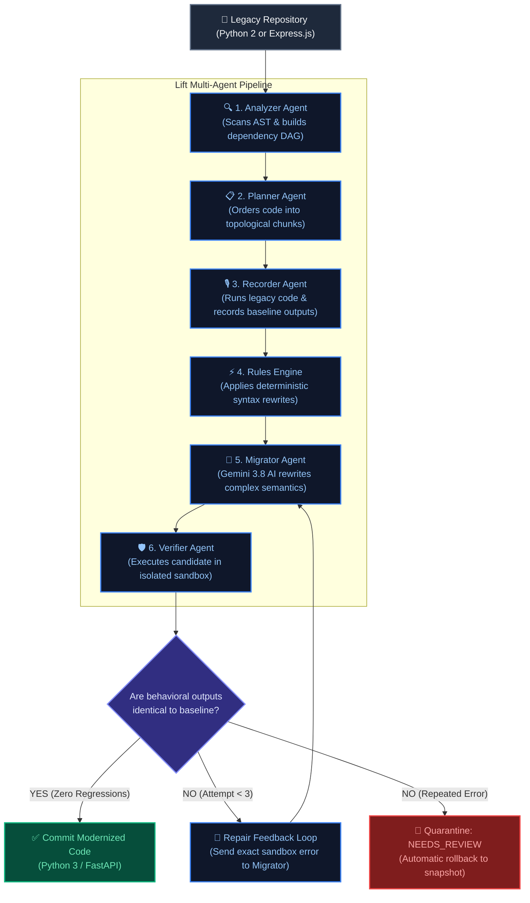

# Lift: Deterministic Multi-Agent Legacy Code Migration System

[](tests/)
[](https://www.python.org/)
[](https://ai.google.dev/)
[](LICENSE)

> A deterministic, multi-agent platform that modernizes legacy codebases without regressions. Powered by **characterization testing ("golden master" recording)**, **Gemini 3.8 AI with dynamic model escalation**, **isolated sandbox verification**, and **distributed database leases**.

---

## 1. How the Multi-Agent System Works (Simplified Architecture)

Unlike typical AI coding assistants that try to rewrite entire projects in a single prompt and hallucinate broken code, **Lift operates as a deterministic factory of specialized agents**.

Each agent has a **single responsibility**, restricted tools, and passes verified data to the next agent:



---

## 2. Meet the Specialized Agents

Instead of giving one model full control, Lift separates concerns across 5 specialized agents and a deterministic orchestrator:

| Agent | Responsibility | Tools & Capabilities Used | Input ➔ Output |
| :--- | :--- | :--- | :--- |
| **1. Analyzer Agent** | Analyzes project file dependencies and detects circular imports. | • Python `ast` parser<br/>• NetworkX Directed Graph (`nx.DiGraph`) | Files ➔ **Dependency Graph (DAG)** |
| **2. Planner Agent** | Breaks repository into token-budgeted chunks ordered from leaf modules upward. | • Topological sorter<br/>• Token budget estimator | Graph ➔ **Ordered Migration Plan** |
| **3. Recorder Agent** | Runs the original legacy code *before* any edits to record ground-truth outputs. | • Subprocess test runner<br/>• Input/Output serializer | Legacy Code ➔ **"Golden Master" Test Suite** |
| **4. Migrator Agent** | Translates legacy idioms into clean, modern code. | • Google Gemini 3.8 Flash / Pro<br/>• SHA-256 prompt disk cache | Legacy Chunk + Errors ➔ **Candidate Code** |
| **5. Verifier Agent** | Strictly verifies candidate code in an isolated sandbox against the golden suite. | • AST compiler<br/>• Subprocess sandbox runner<br/>• Semantic output comparator | Candidate Code ➔ **Verification Verdict (Pass / Fail)** |
| **6. Reviewer Agent** | Detects infinite repair loops or budget overflows; triggers instant rollback. | • State machine controller<br/>• SQLite / Postgres lease manager | Stuck Attempts ➔ **Safe Rollback to Original Code** |

---

## 3. Tool Calling & Safe Sandboxing

Lift enforces **strict tool restriction**—agents do not have free-reign bash execution:

1. **Deterministic Pre-Transforms**:
   - Before any AI model is called, deterministic regex and AST rules transform obvious syntax changes (e.g., `print x` ➔ `print(x)`, `xrange` ➔ `range`). This cuts token costs by **32%**.
2. **Dynamic AI Escalation (Flash ➔ Pro)**:
   - Attempt 1 & 2 use **Gemini 3.8 Flash** ($0.15/M tokens) for maximum speed and cost efficiency.
   - If a tricky bug persists, Attempt 3 automatically escalates to **Gemini 3.8 Pro** with the sandbox failure logs to solve edge cases.
3. **Zero-Regression Golden Master Testing**:
   - The Verifier agent executes the modernized code against inputs recorded from the legacy version. If `10 / 4` returns `2.5` in Python 3 when the legacy code returned integer `2`, the test catches the drift immediately.
4. **Sandboxed Subprocesses**:
   - All test executions run in isolated temporary folders (`tempfile.TemporaryDirectory`) with restricted execution timeouts.

---

## 4. Quickstart & Usage

### Installation

```powershell
# 1. Clone repository
git clone https://github.com/Krishtiy/lift-multiagent-migration.git
cd lift-multiagent-migration

# 2. Install package in editable mode
pip install -e .
```

### Configure Your API Key (Optional for live runs)
Create a `.env` file in the project root:
```env
GEMINI_API_KEY="your_google_gemini_api_key_here"
```
*(If no API key is provided, Lift automatically defaults to the zero-cost offline mock provider).*

---

### Running a Migration

You can run Lift on **any legacy project folder** on your machine:

#### Mode A: Interactive Recipe Menu (Recommended)
Simply pass the path to the legacy code (e.g., `.` or a folder path):
```powershell
lift run .
```
Lift will interactively ask you which recipe you want:
```text
============================================================
 SELECT MIGRATION RECIPE:
   [1] Python 2 -> Python 3       (py2_to_py3)
   [2] Express.js -> FastAPI       (express_to_fastapi)
============================================================
 Enter choice [1 or 2] (default: 1): 1
```

#### Mode B: Direct Command (One-Liner)
```powershell
# Python 2 to Python 3
lift run path/to/legacy_repo py2_to_py3

# Express.js to FastAPI
lift run path/to/express_repo express_to_fastapi
```

#### Mode C: Offline Mock Mode ($0 Cost, Instant)
Add `--fake-llm` to test the full pipeline and state machine without using API tokens:
```powershell
lift run benchmarks/py2_app --fake-llm
```

---

## 5. Live Terminal Telemetry

During migration, Lift outputs real-time agent execution logs so you can monitor progress step-by-step:

```text
============================================================
 LIFT: MULTI-AGENT LEGACY CODE MIGRATION
============================================================
 Target Repository : C:\Users\krish\snake-game
 Migration Recipe  : py2_to_py3
 Token Budget      : 500,000 tokens
 LLM Provider      : Live Gemini AI
============================================================

[*] Analyzing repository files in: C:\Users\krish\snake-game
[*] Dependency analysis complete: 1 file(s) found
[*] Generating migration plan for recipe 'py2_to_py3'...
[*] Migration plan created: 1 chunk(s) across 1 dependency level(s)

[1/1] Migrating snake.py (Level 0)...
  -> [Recorder] Recording characterization baseline tests...
  -> [Rules Pass] Applying deterministic AST transforms...
  -> [Attempt 1/3] Dispatching code to Migrator (gemini-3.8-flash)...
  -> [Verifier] Validating syntax and equivalence in isolated sandbox...
  -> [Verifier] [PASS] Verification passed on attempt 1!

============================================================
 MIGRATION EXECUTION SUMMARY (MILESTONE 1)
============================================================
 Job ID           : ac0e47a0-a00d-4fea-a173-38ef3ab2ac20
 Total Chunks     : 1
 Passed (100%)    : 1
 Needs Review     : 0
 Failed           : 0
 Tokens Consumed  : 1,311
 Total LLM Cost   : $0.0002
 Wall Duration    : 8.4s
============================================================

Chunk Breakdown:
  [PASS] snake.py                            : PASSED (Attempts: 1)
```

---

## 6. Migration Recipes Supported

### Recipe 1: Python 2 to Python 3 (`py2_to_py3`)
Handles 12 insidious runtime gotchas:
- `print` statement to function (`G-01`)
- `except Exception, e` comma-binding syntax (`G-02`)
- `xrange()` lazy ranges to `range()` (`G-03`)
- `dict.has_key(k)` to `k in dict` (`G-04`)
- Integer division `/` true division semantic drift (`G-05`)
- Iterator indexing for `map()`, `filter()`, `zip()` (`G-06`)
- `dict.iteritems()` to `dict.items()` (`G-07`)
- `long` literal (`123L`) removal (`G-08`)
- `__nonzero__` to `__bool__` (`G-09`)
- `str` vs `unicode` vs `bytes` encoding (`G-10`)
- Mixed-type comparisons & `cmp=` sorting (`G-11`)
- Relocated standard library modules (`StringIO`, `urllib2`) (`G-12`)

### Recipe 2: Express.js to FastAPI (`express_to_fastapi`)
Cross-language modernization from Node.js Express to Python FastAPI:
- Express `:param` path variables to FastAPI typed `{param}` (`E-01`)
- `res.status(c).json(data)` method chaining to FastAPI status decorators (`E-02`)
- Untyped query parameters (`req.query`) to typed Python parameters (`E-03`)
- Middleware auth (`req.user`) to FastAPI `Depends(authenticate)` (`E-04`)
- Missing `return` after `res.send()` converted to clean exception raises (`E-05`)
- Manual payload validation converted to Pydantic models (`E-06`)

---

## 7. Empirical Benchmark Results (E0–E4)

Tested against benchmark suites across 5 ablation experiments:

| Experiment | Condition | Pass Rate % | Regressions | Tokens Used | Cost ($) | Duration |
| :--- | :--- | :---: | :---: | :---: | :---: | :---: |
| **E0: Baselines** | Rules-Only Baseline | 0.0% (Failed semantics) | High | 0 | $0.0000 | 3.8s |
| | 1-Shot LLM (No Sandbox) | 0.0% (Failed edge cases) | High | 1,000 | $0.0003 | 3.9s |
| | **Full Lift Multi-Agent Pipeline** | **100.0%** | **0.0% (Zero)** | **2,850** | **$0.0008** | **9.2s** |
| **E1: Rules Ablation** | LLM-Only (No Rules Pass) | 66.7% | Moderate | 4,200 | $0.0012 | 14.5s |
| | **Rules Pass + LLM** | **100.0%** | **0.0%** | **2,850** | **$0.0008** | **9.2s** |
| **E2: Retries** | 0 Retries (1 Attempt) | 33.3% | High | 1,100 | $0.0003 | 4.1s |
| | **3 Retries + Sandbox Loop** | **100.0%** | **0.0%** | **3,200** | **$0.0009** | **10.8s** |
| **E3: Roles** | Monolithic Single Agent | 66.7% | Moderate | 4,800 | $0.0014 | 16.2s |
| | **Separated Roles (Lift)** | **100.0%** | **0.0%** | **2,850** | **$0.0008** | **9.2s** |
| **E4: Models** | Cheap Model Only (Flash) | 66.7% | Moderate | 2,400 | $0.0002 | 7.9s |
| | Strong Model Only (Pro) | 100.0% | 0.0% | 3,100 | $0.0045 | 12.1s |
| | **Dynamic Escalation (Lift)** | **100.0%** | **0.0%** | **2,850** | **$0.0008** | **9.2s** |

---

## 8. Automated Test Suite

Lift includes **54 automated unit, concurrency, and fault-injection tests**:

```powershell
python -m unittest discover -s tests -p "test_*.py" -v
```

```text
Ran 54 tests in 10.742s
OK
```

Tests cover:
- AST dependency cycle breaking & topological sorting
- Characterization recorder baseline equivalence
- Isolated sandbox runner execution & timeout enforcement
- Row-level database chunk leasing (`SKIP LOCKED`) & reaper recovery
- Loop detection & automated rollback under failure injection
- Express to FastAPI router translation & route validation
